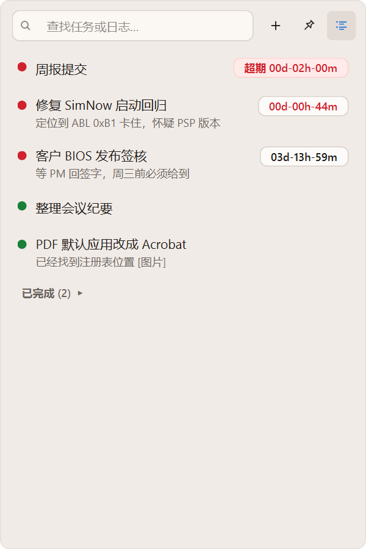
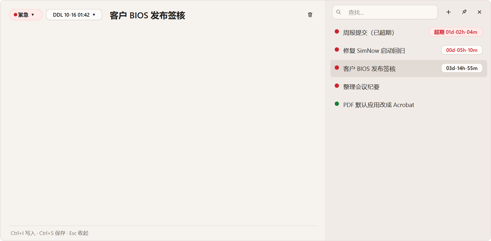
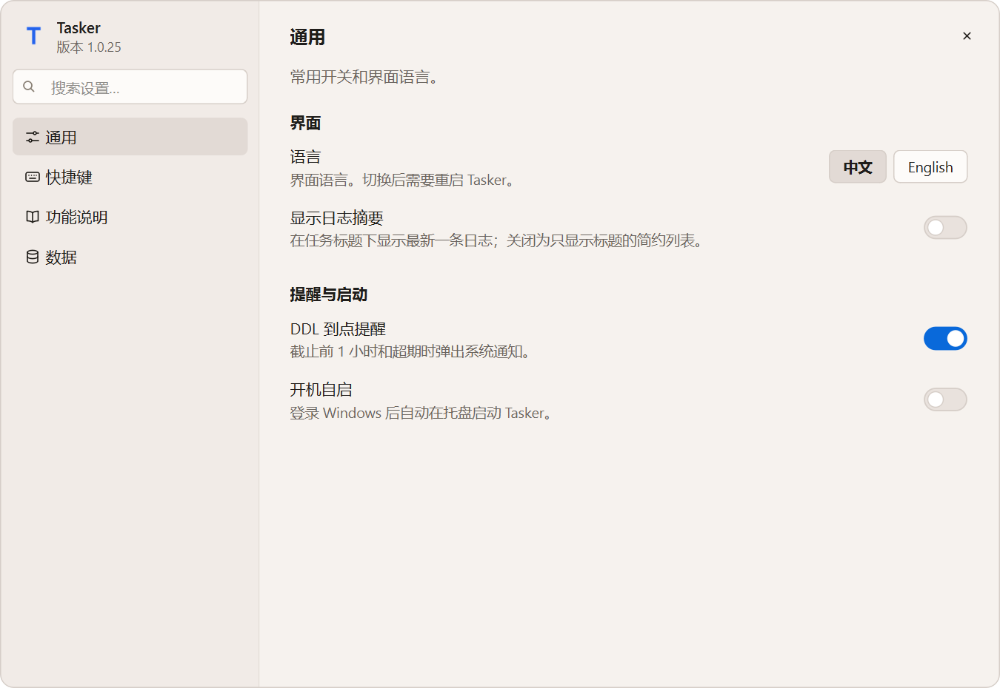

# Tasker

**当前版本：1.0.26**　·　[下载 / 更新日志](https://github.com/877881029/Tasker-releases/releases)　·　[CHANGELOG](CHANGELOG.md)

Windows 桌面上的轻量任务 + 工作日志。窗口贴在屏幕一侧列出当前任务，点开在左侧写带时间戳的日志；紧急任务可设 DDL 倒计时。数据是本机 Markdown 文件，不联网、不需要账号。

<p>
  
  
</p>

## 安装（推荐）

在 PowerShell 里运行一行（安装与升级相同，数据会保留）：

```powershell
irm https://github.com/877881029/Tasker-releases/releases/latest/download/install.ps1 | iex
```

它会下载最新版到 `%LOCALAPPDATA%\Programs\Tasker`，在桌面放 `Tasker` 快捷方式并启动。也可以在 [Releases](https://github.com/877881029/Tasker-releases/releases) 下载 zip，解压后运行 `Tasker\Tasker.exe`。仅支持 Windows 10/11 x64。

## 能做什么

| 功能 | 怎么用 |
|---|---|
| 任务与状态 | `+` 或 `Ctrl+N` 新建；右键任务改 普通 / 紧急 / 已完成 |
| DDL 倒计时 | 紧急任务在详情或右键菜单设 DDL，列表右侧显示 `03d-14h-57m`，按截止先后排序；到点前 1 小时和超期弹通知，托盘显示超期数 |
| 工作日志 | 详情里 `Ctrl+I` 写一条带时间戳的日志，`Ctrl+S` 保存，`Esc` 收起；只读视图里的网址可点击 |
| 快速记录 | 任何程序里按全局快捷键（默认 `Win+Alt+T`，被占用则 `Ctrl+Alt+T`）弹出输入框，回车即记；`!` 开头设为紧急 |
| 搜索 | 搜标题和日志；也可输入 `紧急` `普通` `已完成` `超期` `今天` `DDL` 筛选 |
| 列表视图 | 右上角列表按钮切换：只看标题 / 显示最新日志摘要；已完成任务折叠在底部 |
| 周报 | 托盘「复制本周周报」或 `Ctrl+Shift+C`，本周日志汇总成 Markdown 复制到剪贴板 |
| 删除 | 进入 Windows 回收站，5 秒内可撤销（`Ctrl+Z`） |
| 窗口 | 拖空白处移动，拖边缘缩放，双击铺满；钉住常驻最上层；`Esc` 隐藏到托盘 |
| 设置 | 右上角齿轮：开关、**自定义全部快捷键**、**中文 / English 界面**、功能说明、数据目录与备份；支持搜索设置 |



## 数据与备份

- 任务：`%LOCALAPPDATA%\Tasker\tasks\<id>.md`（YAML 头 + 日志正文），设置：`settings.json`。
- 每天第一次启动自动备份到「文档\Tasker\backups」（zip，保留 7 份），设置里可关闭或立即备份。
- 卸载：删除 `%LOCALAPPDATA%\Programs\Tasker` 和桌面快捷方式；数据目录按需保留。

## 从源码运行 / 开发

需要 Python 3.12。

```powershell
.\scripts\setup.ps1 -Dev            # 装依赖、打包 dist\Tasker\Tasker.exe 并启动
.\scripts\setup.ps1 -Dev -SkipBuild # 只装环境，用 .venv 直接运行
.\.venv\Scripts\python.exe -m pytest -q
```

- 依赖锁定在 `pyproject.toml`（PySide6 6.11.2）。首次安装约 400 MB 下载。
- 跑测试**不要**给 pytest 加 `-p ...` 参数：Qt WebEngine 会解析进程命令行并崩溃。
- 环境变量：`TASKER_DATA_DIR` 换数据目录；`TASKER_SKIP_SHELL_INTEGRATION=1` 不创建桌面快捷方式；`TASKER_NO_RECYCLE=1` 删除不进回收站；`TASKER_BACKUP_DIR` 换备份目录。
- 首次运行会在桌面创建 / 刷新 `Tasker` 快捷方式。

## 发布新版本

```powershell
.\.venv\Scripts\python.exe scripts\bump_version.py   # patch +1，同步 VERSION 与 exe 版本信息
# 更新 CHANGELOG.md、README.md 顶部版本、docs/STATUS.md，提交并推送
.\scripts\release.ps1                                # 打包并发布到 Tasker-releases，只保留最近 5 版
```

## 给接手的人 / Agent

先读 `AGENTS.md` → `docs/STATUS.md` → `docs/superpowers/process.md`。规格在 `docs/superpowers/specs/`，计划在 `docs/superpowers/plans/`。

## 许可

[MIT](LICENSE)
